<div align="center">

# Revisiting the Power of Prior

### A Reproduction and Error Analysis of Training-Free Open-Vocabulary Segmentation with LLaVA

**Mohit Meemrauth** · **Vyom Shah**<br>
Indian Institute of Technology Jodhpur

[](reports/neurips/llava_prior_report.pdf)
[](https://github.com/zbf1991/FSeg-LLaVA)


<br>

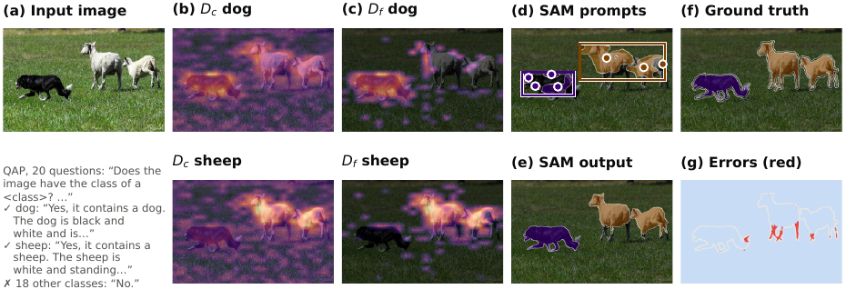

<sub><i>The pipeline on a real VOC val image, showing our implementation's intermediate outputs: LLaVA's yes/no answers → class-token response map → reliable map → SAM prompts → SAM output.</i></sub>

</div>

---

## Overview

**FSeg-LLaVA** ([Zhang et al., CVPR 2026](https://github.com/zbf1991/FSeg-LLaVA)) segments images
**without any segmentation training**. A frozen LLaVA model decides *which* classes are present and
gives a coarse *where* for each one; the Segment Anything Model (SAM) then turns that prior into
sharp masks.

We **reimplemented the method from scratch** in Hugging Face Transformers, ran the **authors' released
code** next to ours, and then took the remaining error apart. The aim is to understand the method,
not to beat it.

> [!NOTE]
> This is a reproduction and analysis project. We do not propose a new segmentation method, and our
> implementation does not beat the original.

### Key findings

| | Finding |
|:-:|---|
| 🔁 | **It reproduces.** Ours: **65.85** mIoU, released code: **66.01**, paper: 68.0. The two implementations agree per image (Pearson *r* = 0.97), so the 2-point gap is shared, not caused by our port. |
| 🔑 | **One hidden detail is worth 17 points.** The class token's hidden state must be read *at* the class-name token. Reading it one position early (a literal port of the `generate()` indexing) drops VOC val to 48.6. |
| 🌍 | **It transfers within the LLaVA family.** LLaVA-1.6 Vicuna (65.02) and Mistral (66.29) work without retuning, and so does COCO-Object (39.99). Qwen2.5-VL does not (22.2), because its hidden states are strongly anisotropic. |
| 🧩 | **Most errors are missed pixels, not confused classes.** 30% of object pixels are left as background and only 2.9% get the wrong class. Using the true class list (oracle recognition) adds +6.3 points on VOC and +10.4 on COCO. |
| 🧠 | **Middle layers make the best SAM prompts.** Deep layers (20–22) give the best stand-alone maps but the worst SAM prompts; layers 7–13 give small, precise seeds. |
| ❌ | **None of our 11 fixes transferred.** The only gain on the tuning split (+1.23) scored −0.15 on validation. |

---

## Results

All numbers are **mIoU** with 95% bootstrap confidence intervals over images. Design choices were made on a
separate **200-image tuning split** taken from VOC *train*; the validation sets were used only for the final numbers.

| System | VLM | Maps only<sup>†</sup> | **Full pipeline** | Oracle recognition<sup>†</sup> |
|---|---|:-:|:-:|:-:|
| ***PASCAL VOC 2012 val** (1,449 images)* | | | | |
| Paper (reported) | LLaVA-1.5-7B | – | 68.0 | – |
| Released code (re-run by us) | LLaVA-1.5-7B | – | 66.01 <sub>[64.3, 67.5]</sub> | – |
| **Ours** | LLaVA-1.5-7B | 18.72 | **65.85** <sub>[64.1, 67.3]</sub> | 72.16 |
| Ours | LLaVA-1.6 Vicuna-7B | 16.45 | 65.02 <sub>[63.4, 66.8]</sub> | 69.46 |
| Ours (β = 0.16) | LLaVA-1.6 Mistral-7B | 19.90 | 66.29 <sub>[64.5, 67.9]</sub> | 70.00 |
| ***COCO-Object val2017** (5,000 images)* | | | | |
| **Ours** | LLaVA-1.5-7B | 18.40 | **39.99** <sub>[38.8, 41.0]</sub> | 50.41 |

<sub>† Diagnostic controls, not methods: <i>maps only</i> scores LLaVA's coarse map without SAM; <i>oracle recognition</i> replaces LLaVA's yes/no answers with the ground-truth class list.</sub>

<p align="center">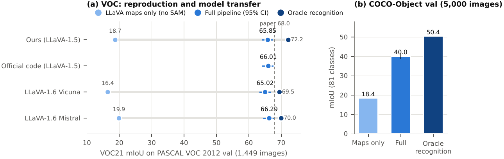</p>

### One example per class

The example for each class is its **median-IoU** object, so each one is a typical case for that class,
not a cherry-picked success.

<p align="center">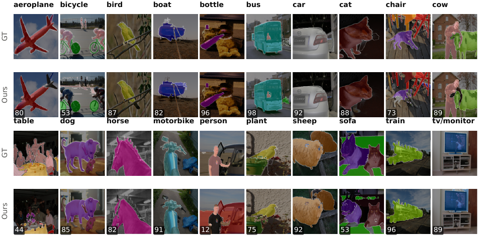</p>

<p align="center">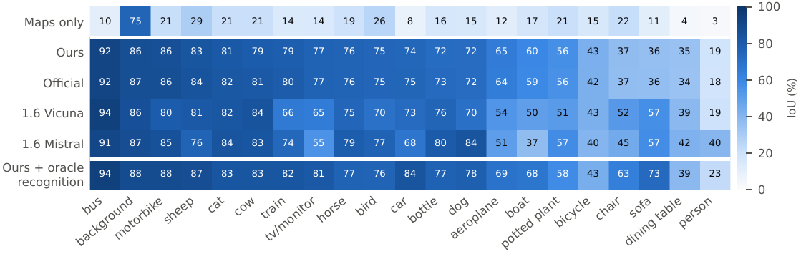</p>

---

## What matters inside the pipeline

<table>
<tr>
<td width="50%">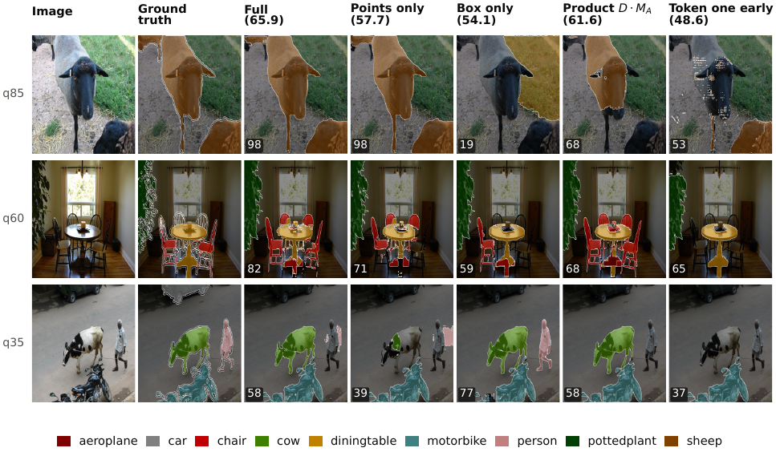</td>
<td width="50%">

| Setting | VOC val mIoU |
|---|:-:|
| **Full reproduction** | **65.85** |
| No prototype step | 65.78 |
| No attention mask | 65.49 |
| Paper-text product `D·M_A` (code uses a union) | 61.62 |
| SAM points only | 57.70 |
| SAM box only | 54.12 |
| Class token read one position early | 48.57 |
| LLaVA maps without SAM | 18.72 |

SAM adds **47 points** over LLaVA's maps. Two details that are *not in the paper text*
(union vs. product, token position) matter more than any ablation the paper lists.

</td>
</tr>
</table>

---

## Where the spatial information sits: layer study

<p align="center">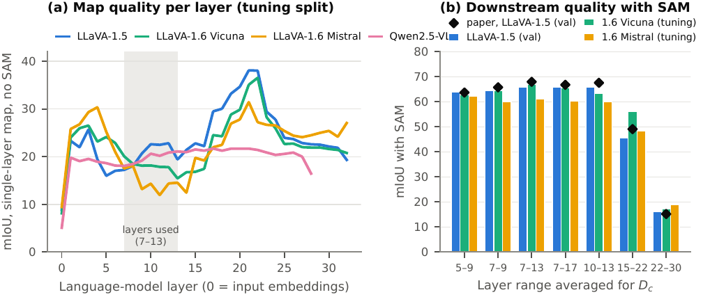</p>

| Layers | Map only | With SAM | Paper (with SAM) |
|:-:|:-:|:-:|:-:|
| 5–9 | 16.3 | 64.0 | 63.7 |
| 7–9 | 17.5 | 64.4 | 65.8 |
| **7–13** | 18.7 | **65.8** | **68.0** |
| 7–17 | 20.1 | 65.9 | 66.8 |
| 10–13 | 20.0 | 65.9 | 67.6 |
| 15–22 | 31.8 | 45.5 | 49.1 |
| 22–30 | 23.8 | 16.1 | 15.2 |

Middle-layer maps mark only 5% of pixels, but 79% of those are correct, so SAM gets reliable seeds.
Deep-layer maps are better on their own but too imprecise as prompts, so SAM's output collapses:

<p align="center">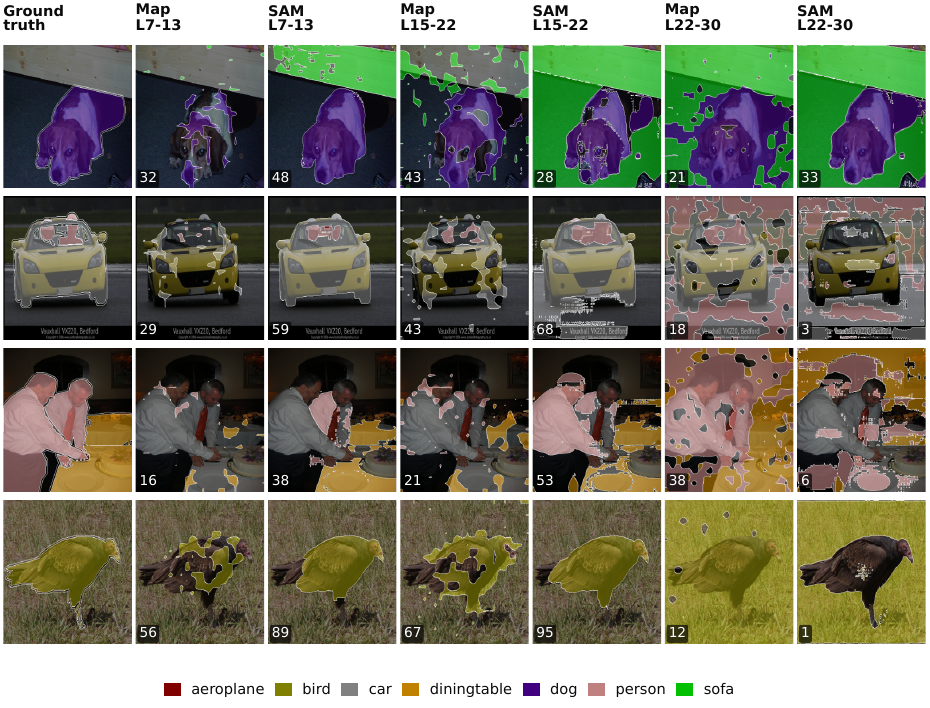</p>

---

## Error analysis

<table>
<tr>
<td width="50%">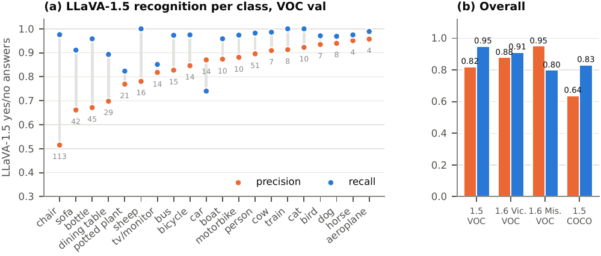</td>
<td width="50%">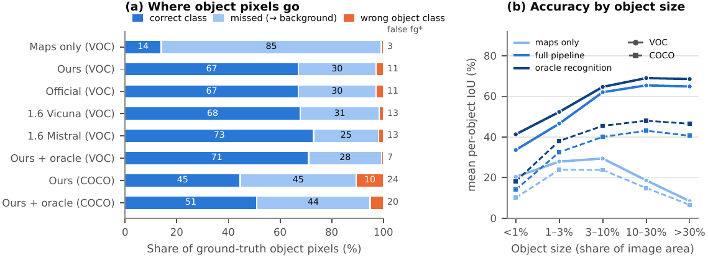</td>
</tr>
<tr>
<td><sub><b>Recognition.</b> LLaVA-1.5 answers "yes" wrongly 442 times on VOC (precision 0.82, recall 0.95). False "yes" answers cluster on furniture in indoor scenes (chair, table, sofa, bottle). On COCO, precision falls to 0.64.</sub></td>
<td><sub><b>Missed pixels, not confused classes.</b> 67% of object pixels are labelled correctly, 30% are left as background, and only 2.9% get the wrong class. Small objects (&lt;1% of the image) fall between the 24×24 grid cells.</sub></td>
</tr>
</table>

### Failure types (with LLaVA's verbatim answers)

<p align="center">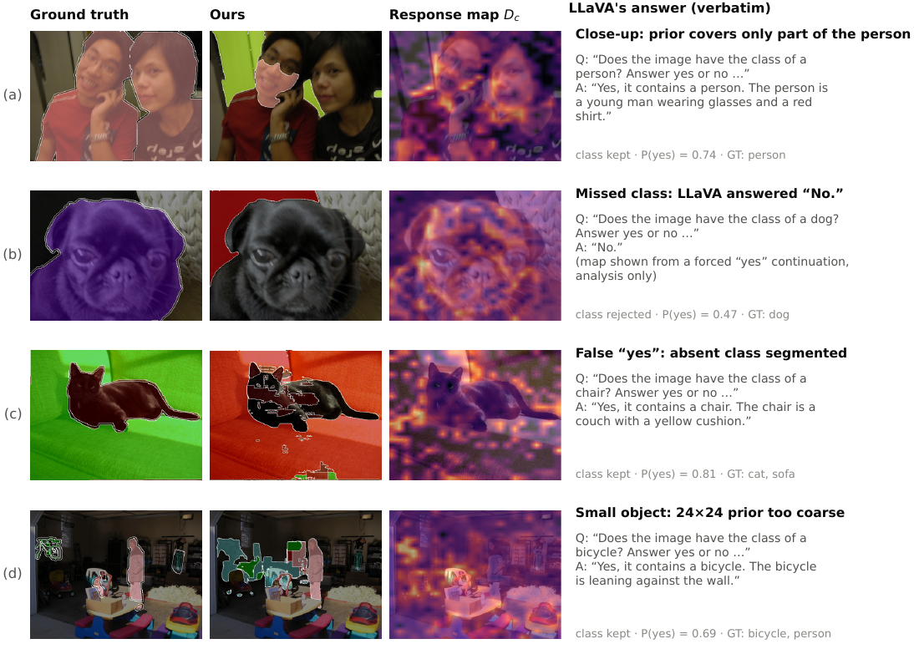</p>

<details>
<summary><b>More examples:</b> oracle recognition, LLaVA-1.6 Mistral on persons, COCO-Object</summary>
<br>

**What oracle recognition fixes.** It removes falsely affirmed classes and restores rejected ones, but it does not fix incomplete extent.
<p align="center">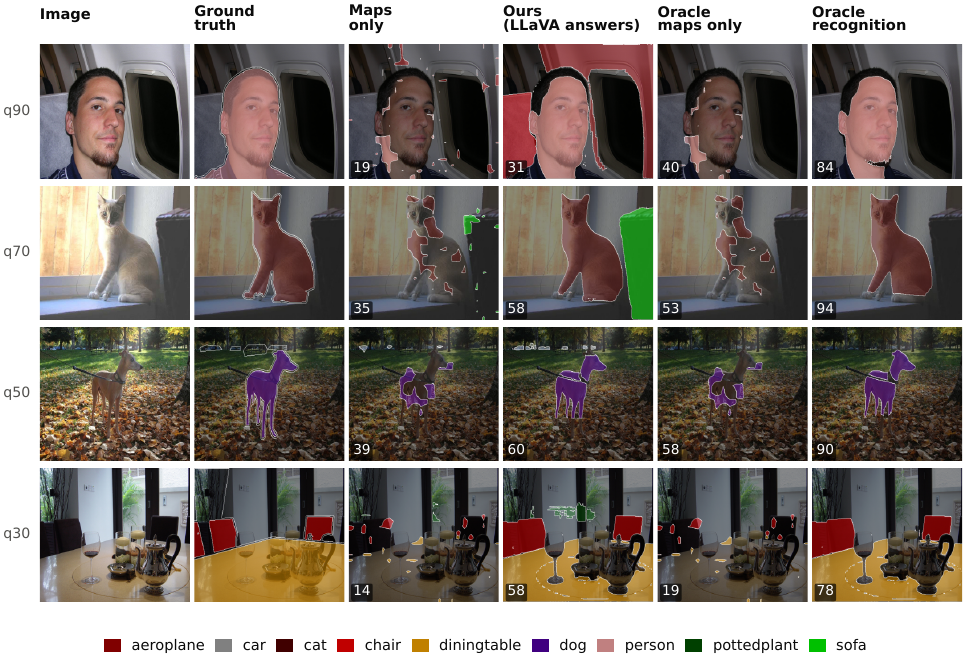</p>

**Large persons: LLaVA-1.5 vs. LLaVA-1.6 Mistral.** Mistral roughly doubles person IoU (40 vs. 19).
<p align="center">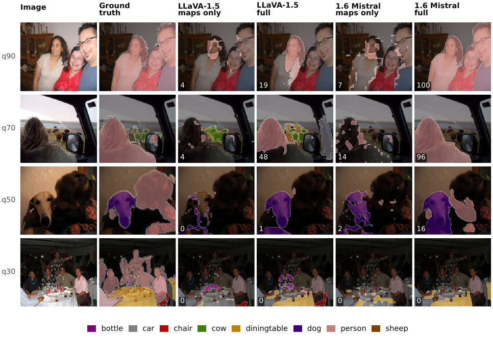</p>

**COCO-Object examples** at fixed percentiles of per-image mIoU.
<p align="center">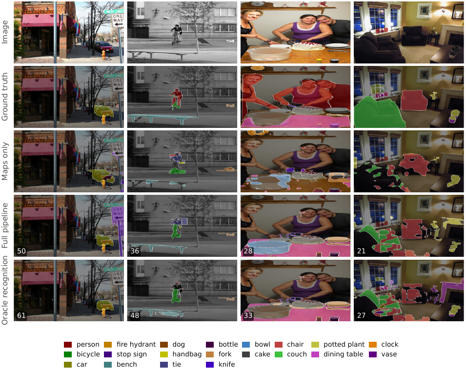</p>

</details>

---

## What did not work

<table>
<tr>
<td width="45%">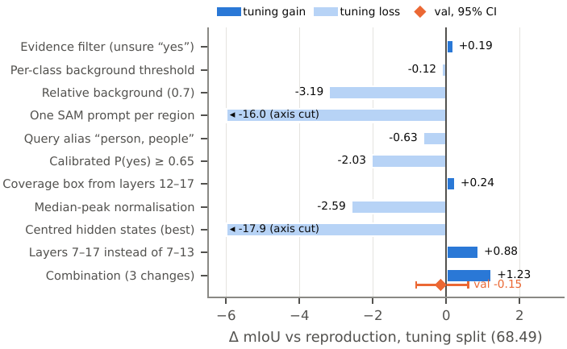</td>
<td>

Each attempt targeted a measured error source and was **chosen on the tuning split only**:

- **Recognition:** evidence filter, calibrated *P*(yes) thresholds, query alias "person, people"
- **Incomplete prior:** per-class / relative backgrounds, extended SAM box, one SAM prompt per region
- **Representation:** map normalisation, hidden-state centring

The only gain above noise (+1.23, a combination of three changes) was frozen and run **once** on
val, where it scored **−0.15**. The gain came from sampling noise in the 200-image split, so the final result is the
plain reproduction.

</td>
</tr>
</table>

---

## Repository layout

```
llava-prior-segmentation/
├── src/llava_prior/        # the implementation
│   ├── trace.py            #   LLaVA stage: answers, P(yes), per-layer maps, attention, CLIP features
│   ├── activation.py       #   response maps, background, prototypes, SAM prompting
│   ├── voc.py              #   drivers (trace / segment / eval) + VOC21 metric
│   ├── qwen.py             #   Qwen2.5-VL adapter
│   └── report.py           #   tables, QAP metrics, figures
├── configs/                # every setting in the report is a JSON config here
├── splits/                 # 200-image tuning split (VOC train, seed 0)
├── slurm/                  # cluster job scripts (run.slurm, layer_study.sh, official.sh)
├── scripts/                # COCO-Object builder, trace checks, job queue runner
├── tests/                  # 55 unit tests (pytest)
├── reports/neurips/        # the report: LaTeX source, figure scripts, stats, PDF
├── docs/figures/           # figures used in this README
└── Neurips Styles/         # NeurIPS 2025 style files + final report PDF
```

---

## Reproducing the results

The cluster runs used one NVIDIA A30 (24 GB). LLaVA is traced **once** per image and cached; every
ablation after that is a SAM-only rerun that takes minutes.

```bash
# environment
python3 -m venv .venv && .venv/bin/pip install -e '.[dev,sam]'
.venv/bin/pytest                                   # 55 passed, 3 skipped

# 1) trace LLaVA on VOC val (~2.8 GPU-h)
llava-prior-voc trace --split val --out runs/traces/val_vocnames

# 2) segment with SAM for every config, then evaluate (~75 min for 8 configs)
llava-prior-voc segment --split val --traces runs/traces/val_vocnames \
    --configs configs/voc_val_core.json --out runs/pred/val_vocnames --save-coarse
llava-prior-voc eval --split val --pred runs/pred/val_vocnames/*/

# 3) tables and recognition metrics
llava-prior-report table --reference base --per-class --pred runs/pred/val_vocnames/*
llava-prior-report qap --split val --traces runs/traces/val_vocnames

# 4) rebuild every figure and the PDF report from the saved runs
bash reports/neurips/build.sh            # add --stats to recompute statistics first
```

On SLURM, wrap each command in `sbatch slurm/run.slurm "<command>"`. Per-run metrics are written to
`runs/pred/<split>/<config>/metrics.json` (with `confusion.npy`).

**Data and weights** are not in Git: PASCAL VOC 2012 trainval (see [`datasets/README.md`](datasets/README.md)),
COCO val2017 (converted to COCO-Object with `scripts/prepare_coco_object.py`), `llava-hf/llava-1.5-7b-hf`,
and SAM ViT-H (`sam_vit_h_4b8939.pth`).

### Implementation facts needed to reproduce FSeg-LLaVA

| Component | Paper text | Released code (used here) | Cost of the paper-text version |
|---|---|---|:-:|
| Combining `D_c` with `M_A` | product | union of threshold mask and `M_A` | −4.23 |
| SAM refinement | single prompt | 3 rounds, previous mask logits fed back | −3.01 (tuning) |
| Class-token hidden state | not specified | read **at** the class-name token | −17.27 |

<details>
<summary><b>Older single-image CLI</b> (<code>llava-prior</code>, laptop implementation of the paper text)</summary>
<br>

The commands below belong to the earlier laptop implementation (`llava-prior`, `pipeline.py`,
`models.py`). It follows the paper text, not the released code (no background map, projected instead
of CLIP features, different prompt and SAM prompting), and was never run to completion. Use
`llava-prior-voc` for results.

Run one image after downloading a LLaVA checkpoint and a SAM checkpoint:

```bash
.venv/bin/llava-prior path/to/image.jpg \
	--classes person dog bicycle \
	--sam-checkpoint path/to/sam_vit_h_4b8939.pth \
	--output-dir outputs/example
```

The output directory contains one binary NumPy mask per detected class and its
coarse VGM prior (saved as `<class>_prior.npy`), so the prior can be inspected
separately from SAM's result. It also contains `semantic_mask.npy` with
background `0` and classes in candidate-list order, `predictions.json`,
`run_metadata.json` with the model/config/device/software settings, and
`visualization.png`. If GPU memory is limited, install the
quantization extra and use int4 to reduce LLaVA's language-model weight memory;
int4 may affect inference quality. Keep SAM on CPU to leave more GPU memory for
LLaVA; quantization does not guarantee that a 7B model fits the available VRAM.
On an 8 GB RTX 3050, the int4 loader still ran out of GPU memory before inference,
so the 100-image experiment has not been run on that hardware. Quanto's CUDA
kernels are compiled on first inference, so CUDA runs also
need the CUDA Toolkit (`nvcc`) and, on Windows, Visual C++ Build Tools installed.
The CLI discovers `CUDA_HOME` from `nvcc` on `PATH` and activates the x64 Visual
Studio Build Tools environment when needed. For a user-local toolkit install,
put its `bin` directory on `PATH` before starting Python:

```powershell
.\.venv\Scripts\python.exe -m pip install -e ".[quant]"
$env:PATH = "D:\Tools\CUDA\v12.1\bin;$env:PATH"
.\.venv\Scripts\llava-prior.exe image.jpg `
	--classes dog `
	--sam-checkpoint checkpoints\sam_vit_h_4b8939.pth `
	--device cuda --sam-device cpu --quantize int4 `
	--output-dir outputs\example
```

The high-resolution visualization uses distinct class colors, bright boundaries,
and per-class pixel coverage. Evaluate an indexed prediction against a PNG or NumPy target:

```bash
.venv/bin/llava-prior-eval outputs/example path/to/target.png \
	--classes person dog bicycle
```

Target labels must use `0` for background, `1..N` for the listed classes, and
`255` for ignored pixels. The evaluator reports mean IoU and per-class IoU; it
does not download VOC21 or claim the paper's reported score automatically.

Run a directory of images with one shared model load. By default, only images
directly inside the directory are included; use `--recursive` for subdirectories.
Each image gets its own output folder, and `batch_summary.json` records successes
and failures. Its `completed_count` includes new successes plus already-complete
images skipped by `--resume`:

```bash
.\.venv\Scripts\llava-prior.exe path\to\images `
	--classes person dog bicycle `
	--sam-checkpoint checkpoints\sam_vit_h_4b8939.pth `
	--device cuda --sam-device cpu --quantize int4 `
	--recursive --output-dir outputs\voc-sample
```

Use `--resume` to skip images whose outputs and run settings match the current
command. Failed images are listed in the batch summary; the command exits with
a nonzero status if any image fails.

For the curated VOC subset, per-image class lists prevent the model from querying
every class on every image while still using one shared model load:

```powershell
$vocClasses = @(
	"aeroplane", "bicycle", "bird", "boat", "bottle", "bus", "car", "cat",
	"chair", "cow", "diningtable", "dog", "horse", "motorbike", "person",
	"pottedplant", "sheep", "sofa", "train", "tvmonitor"
)
.\.venv\Scripts\llava-prior.exe `
	.\datasets\VOC2012\curated\images `
	--classes $vocClasses `
	--class-map .\datasets\VOC2012\curated\class_map.json `
	--sam-checkpoint .\checkpoints\sam_vit_h_4b8939.pth `
	--device cuda --sam-device cpu --quantize int4 `
	--output-dir .\outputs\voc-curated
```

Evaluate batch outputs on the curated diagnostic subset of the official VOC
validation split. This 40-image subset is class-balanced but is not a replacement
for evaluation on the full validation split. VOC's native foreground class IDs
are remapped to the candidate class order; background stays `0`, void pixels
(`255`) are ignored, and VOC classes not requested for inference are excluded
from the score rather than treated as background:

```powershell
$vocClasses = @(
	"aeroplane", "bicycle", "bird", "boat", "bottle", "bus", "car", "cat",
	"chair", "cow", "diningtable", "dog", "horse", "motorbike", "person",
	"pottedplant", "sheep", "sofa", "train", "tvmonitor"
)
.\.venv\Scripts\llava-prior-eval-voc.exe `
	.\outputs\voc-curated `
	.\datasets\VOC2012\VOCdevkit\VOC2012 `
	--classes $vocClasses `
	--split-file .\datasets\VOC2012\curated\image_ids.txt `
	--output .\outputs\voc-curated\voc_metrics.json
```

### Label-independent VOC experiment

The curated subset above uses annotations both to select examples and to limit
each image's candidate classes. Treat its score as a diagnostic, not as an
unbiased open-vocabulary benchmark. For a label-independent experiment, select
a deterministic random sample from the official validation IDs and query all
20 VOC classes on every image. The sampler reads the validation ID list and
images only; it does not read segmentation masks or create a per-image class
map. The default seed is `2026`; use a fresh, empty output directory:

```powershell
.\.venv\Scripts\llava-prior-prepare-voc.exe `
	.\datasets\VOC2012\VOCdevkit\VOC2012 `
	--selection random `
	--image-count 100 `
	--seed 2026 `
	--output-dir .\datasets\VOC2012\random-100
```

Run all 20 candidate classes on this sample. Do not pass `--class-map`; keep
the generated `manifest.json` and `image_ids.txt` with the experiment:

```powershell
$vocClasses = @(
	"aeroplane", "bicycle", "bird", "boat", "bottle", "bus", "car", "cat",
	"chair", "cow", "diningtable", "dog", "horse", "motorbike", "person",
	"pottedplant", "sheep", "sofa", "train", "tvmonitor"
)
.\.venv\Scripts\llava-prior.exe `
	.\datasets\VOC2012\random-100\images `
	--classes $vocClasses `
	--sam-checkpoint .\checkpoints\sam_vit_h_4b8939.pth `
	--device cuda --sam-device cpu --quantize int4 `
	--resume `
	--output-dir .\outputs\voc-random-100
```

Evaluate exactly the sampled IDs and verify that every image's recorded
inference settings include all 20 candidate classes:

```powershell
.\.venv\Scripts\llava-prior-eval-voc.exe `
	.\outputs\voc-random-100 `
	.\datasets\VOC2012\VOCdevkit\VOC2012 `
	--classes $vocClasses `
	--split-file .\datasets\VOC2012\random-100\image_ids.txt `
	--require-all-candidates `
	--output .\outputs\voc-random-100\voc_metrics.json
```

This is a random 100-image validation sample, not the full VOC validation
benchmark. To cover the full 1,449-image split with the same fixed all-class
policy, set `--image-count 1449`, use a separate output directory, and pass its
`image_ids.txt` to evaluation. Full-split inference can be substantially more
expensive because each image is queried with every candidate class.

### Reproducible ablations

`--config` accepts a JSON object containing overrides for the segmentation
settings. The effective config is saved into every image's `run_metadata.json`
and participates in `--resume` matching. Example variants are provided under
`configs/ablations/` for the TVR layer range, attention top-K, and response
threshold. Use the same image IDs, candidate classes, model, and quantization
for every run, and keep each variant in its own output directory:

```powershell
.\.venv\Scripts\llava-prior.exe `
	.\datasets\VOC2012\random-100\images `
	--classes $vocClasses `
	--config .\configs\ablations\layers_4_10.json `
	--sam-checkpoint .\checkpoints\sam_vit_h_4b8939.pth `
	--device cuda --sam-device cpu --quantize int4 `
	--resume `
	--output-dir .\outputs\voc-random-100-layers-4-10
```

Repeat with `attention_top_k_1.json` and `threshold_alpha_0_5.json`, changing
the output directory for each run. Evaluate each output against the same
`random-100\image_ids.txt` using `--require-all-candidates`; this verifies the
candidate class list, while the saved run metadata lets you record and compare
the other settings. These variants change one setting each relative to the
paper defaults.

To evaluate only a selected subset, pass a text file containing one VOC image ID
per line with `--split-file`. Predictions must exist under the output folder as
`<image-id>\semantic_mask.npy`, together with `<image-id>\predictions.json`.
The reported dataset mIoU accumulates each class's intersection and union across
the whole split before averaging class IoUs.

Large checkpoints and datasets should be stored outside Git. The paper-default
configuration is recorded in [configs/voc21.json](configs/voc21.json).
The official VOC 2012 train/validation archive can be stored locally under
`datasets/VOC2012`; see [datasets/README.md](datasets/README.md) for its source,
contents, and label details. Dataset files are excluded from Git.

</details>

---

## Acknowledgements

We thank the authors of [FSeg-LLaVA](https://github.com/zbf1991/FSeg-LLaVA) for releasing their code,
and IIT Jodhpur for access to its GPU cluster. This project builds on
[LLaVA](https://github.com/haotian-liu/LLaVA), [Segment Anything](https://github.com/facebookresearch/segment-anything),
[PASCAL VOC](http://host.robots.ox.ac.uk/pascal/VOC/) and [COCO](https://cocodataset.org/).

## Citation

If you use this reproduction, please cite the original paper:

```bibtex
@inproceedings{zhang2026prior,
  title     = {The Power of Prior: Training-Free Open-Vocabulary Semantic Segmentation with LLaVA},
  author    = {Zhang and others},
  booktitle = {CVPR},
  year      = {2026}
}
```
